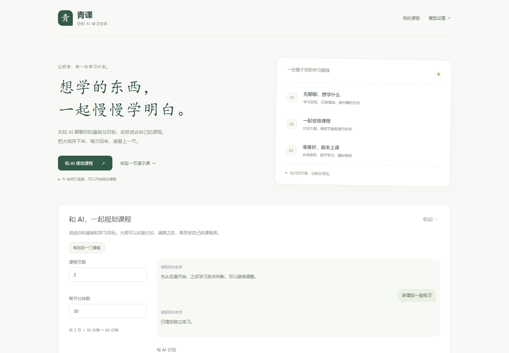

<div align="center">

# 青课 · Qingke

### 一块白板，一位随时可以打断的 AI 老师。

讨论学习目标 · 安排自己的课程 · 边听边看边提问


[快速开始](#快速开始) · [连接模型](#连接模型) · [数据与隐私](#数据与隐私)

</div>



## 功能一览

| 功能 | 体验 |
| --- | --- |
| 🌱 课程规划 | 与 AI 多轮讨论目标、基础、难度和练习 |
| 📚 自选课时 | 1–40 节课，每节预计 5–120 分钟；大纲可本地保存、导出 |
| ✍️ 白板课堂 | 随讲解呈现关键词、公式、表格与箭头 |
| 💬 随时提问 | 文字或浏览器支持的语音插话，补讲后继续原课 |
| 🔖 进度恢复 | 按课节保存板书、对话及播放位置，刷新后手动继续 |
| 🔊 语音讲解 | 系统朗读或自定义 TTS，支持中英文分段 |


> 当前为个人本机使用的原型。无需密钥即可体验内置演示；演示讲解和示例补讲为预写内容，界面会明确标注。

## 快速开始

准备 **Node.js 22.19 或更新版本**，下载仓库并进入项目目录：

```bash
npm ci
npm run dev
```

打开 [http://127.0.0.1:5173](http://127.0.0.1:5173)，点击「体验一节演示课」。

生产构建与启动：

```bash
npm run build
npm start
```

打开 [http://127.0.0.1:8787](http://127.0.0.1:8787)。服务默认监听本机地址。

## 连接模型

首页右上角打开「模型设置」，填写兼容 **Chat Completions** 的服务地址、模型名称与密钥。服务需要支持 **JSON 输出**；支持流式响应时可在首段准备好后开始讲解。

也可以复制 [`.env.example`](.env.example) 为 `.env`，填写 `AI_API_KEY`、`AI_BASE_URL`、`AI_MODEL`；视觉模型另设 `AI_VISION=true`。手动修改后重启服务。

自定义语音可在课堂语音设置中填写，或配置 `TTS_API_KEY`、`TTS_BASE_URL`、`TTS_MODEL`、`TTS_VOICE`。所选音色需要支持相应语言。未配置时使用系统朗读，语音不可用时按阅读节奏展示字幕与板书。

## 学习流程

1. 设置课程节数和预计时长，描述基础与目标。
2. 继续讨论、调整大纲，再点击「保存大纲到本地」。
3. 从「我的课程」选课并开始讲解，随时暂停或提问。
4. 补讲后点击「继续原课」，课节结束后进入下一节。

长课分批生成，并在播放时预备后续内容。课时是预计学习时间，实际受语速、提问和练习影响。修改并重新保存大纲后，对应课节按新版本重新开始。

## 数据与隐私

| 数据 | 保存位置 | 仓库处理 |
| --- | --- | --- |
| 模型与 TTS 配置、密钥 | 本地 `.env` | 忽略配置文件，仅保留无密钥的 `.env.example` |
| 课程大纲及讨论 | `data/course-plans/` | 整个 `data/` 均忽略 |
| 板书、对话与学习进度 | 浏览器本地存储 | 不属于仓库文件 |
| 旧版 PDF 课件 | 浏览器 IndexedDB | 不上传到仓库 |
| 依赖、构建、缓存和日志 | 本地工作目录 | 已加入忽略规则 |

网页保存的模型与语音配置会写入本地 `.env`；密钥不会返回前端。真实规划、授课和问答会把相关学习内容发送给配置的模型服务；自定义 TTS 会把待朗读文本发送给语音服务。浏览器语音识别也可能联网。清除浏览器数据会删除对应本地记录。

本项目尚无账户和多人数据隔离，适合个人本机使用。公开部署需要另外设计身份验证、访问控制与配置管理。GitHub Pages 无法运行所需的 Node.js 后端。

## 开发与验证

```bash
npm test
npm run build
```

自动测试覆盖课程规划、课时校验、分批生成、结构化板书、语音处理、持久化和服务配置。

<details>
<summary>浏览器集成检查</summary>

完成构建并安装 Chromium 后运行：

```bash
npx playwright install chromium
node scripts/classroom-check.mjs
node scripts/classroom-latency-check.mjs
node scripts/classroom-buffer-check.mjs
node scripts/course-planner-check.mjs
```

检查使用本机模拟模型与语音，覆盖打断、续讲、预备请求、选课恢复和布局；模拟耗时不代表真实服务响应速度。

</details>

| 目录 | 内容 |
| --- | --- |
| `src/` | 首页、课程规划、白板与播放控制 |
| `server/` | 本地 API、模型代理、语音与课程存储 |
| `shared/` | 教学协议、校验与语音处理 |
| `scripts/`、`tests/` | 开发工具、自动测试与匿名测试夹具 |
| `docs/` | 演示界面预览 |

技术栈：TypeScript、Vite、Konva、Lucide、PDF.js、Rough.js、perfect-freehand。第三方来源及许可见 [THIRD_PARTY_NOTICES.md](THIRD_PARTY_NOTICES.md)。当前尚未为原创代码指定开源许可证。

## 当前边界

- 教学质量、模型首段响应与 TTS 音质需在实际服务中验证。
- 语音插话的兼容性和延迟因浏览器、设备而异，建议戴耳机。
- 续讲从被打断的短段开头重讲；尚未实现板书与音频逐词对齐。
- 源码保留旧版 PDF、批注与测验实现；当前首页以规划和白板课堂为主。

---

<div align="center">

**把好奇留下来，把知识慢慢学明白。**

</div>
